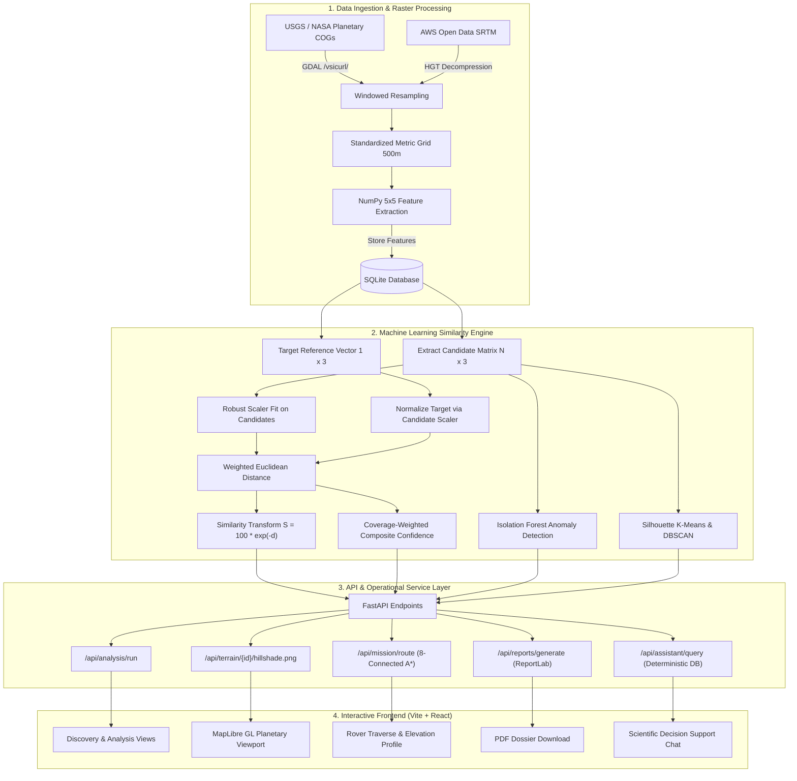

# ASTRA-X — System Architecture & Data Flow

**Platform:** ASTRA-X ("Discover Earth. Understand Other Worlds. Prepare for Exploration.")  
**Engineering Team:** CASSINI-X  

---

## 1. Directory Structure

```text
astra-x/
├── backend/
│   ├── app/
│   │   ├── analysis/             # Scientific ML & numerical analysis modules
│   │   │   ├── anomaly.py        # Isolation Forest outlier detection
│   │   │   ├── clustering.py     # Silhouette K-Means & DBSCAN topology
│   │   │   ├── confidence.py     # Composite confidence score calculation
│   │   │   ├── engine.py         # End-to-end analysis orchestration
│   │   │   ├── features.py       # NumPy terrain feature extraction (slope, roughness)
│   │   │   ├── normalize.py      # Robust Scaler (median, IQR)
│   │   │   ├── pathfinding.py    # 8-connected A* traverse with octile heuristic
│   │   │   ├── search.py         # Weighted Euclidean nearest-neighbor search
│   │   │   ├── validate.py       # Leave-one-out benchmark validation pipeline
│   │   │   └── visualize.py      # Hillshade & slope PNG raster tile renderer
│   │   ├── assistant/            # Scientific Assistant
│   │   │   └── engine.py         # Grounded deterministic query synthesis
│   │   ├── ingest/               # Ingestion & geospatial processing pipelines
│   │   │   ├── cli.py            # Dataset ingestion CLI entrypoint
│   │   │   ├── srtm.py           # Earth SRTM 1-arc-second downloader
│   │   │   ├── planetary.py      # USGS MOLA & LOLA COG stream processing
│   │   │   └── spectral_base.py  # Spectral provider registry (EMIT, M3, CRISM)
│   │   ├── reports/              # Scientific documentation export
│   │   │   └── pdf_generator.py  # ReportLab + Matplotlib PDF compiler
│   │   ├── db.py                 # SQLite database engine, session factory, migrations
│   │   ├── models.py             # SQLAlchemy 2.0 ORM schemas
│   │   ├── schemas.py            # Pydantic v2 API request/response contracts
│   │   └── main.py               # FastAPI application endpoints & middlewares
│   ├── data/                     # Ingested DEM GeoTIFFs, SQLite DB, PDF archive
│   ├── tests/                    # 47 unit & API integration test cases
│   └── requirements.txt          # Python dependencies
│
├── frontend/
│   ├── src/
│   │   ├── api/
│   │   │   └── client.ts         # Strongly-typed fetch API client & contracts
│   │   ├── components/
│   │   │   ├── ui/               # Reusable design system (Card, Badge, Button, etc.)
│   │   │   ├── Layout.tsx        # Navigation shell, header, banner, footer
│   │   │   ├── PlanetaryMap.tsx  # MapLibre GL raster viewer (Mars, Moon, Earth)
│   │   │   └── EarthMap.tsx      # Global terrestrial analog MapLibre view
│   │   ├── pages/                # Application routes
│   │   │   ├── Home.tsx          # Landing page & featured analogs
│   │   │   ├── Dashboard.tsx     # System status & catalog stats
│   │   │   ├── Discovery.tsx     # Terrestrial Analog Explorer
│   │   │   ├── Explorer.tsx      # Multi-body Planetary Map Explorer
│   │   │   ├── Analysis.tsx      # 6-tab Mathematical AI Analysis
│   │   │   ├── Geology.tsx       # Spectral & surface material intelligence
│   │   │   ├── Mission.tsx       # Landing screening & A* rover pathfinding
│   │   │   ├── Reports.tsx       # PDF Dossier compilation & download
│   │   │   ├── Assistant.tsx     # Deterministic Scientific Assistant
│   │   │   └── About.tsx         # Mission charter & methodology
│   │   └── styles/               # Tailwind CSS & Starfield styling
│   ├── dist/                     # Optimized production bundle
│   └── vitest.config.ts          # Frontend unit testing configuration
│
├── docs/                         # Comprehensive architectural documentation
│   ├── ARCHITECTURE.md
│   ├── DATA_SOURCES.md
│   ├── LIMITATIONS.md
│   ├── ROADMAP.md
│   └── VALIDATION.md
│
└── scripts/                      # Operational utilities
    ├── smoke_test.py             # End-to-end pipeline verification
    └── measure_performance.py    # Latency benchmarking
```

---

## 2. End-to-End Data Flow



---

## 3. Strict Metric Separation Principle
ASTRA-X enforces strict architectural separation between three distinct evaluation axes across all schemas, APIs, and UI cards:

1. **Similarity Score ($S$)**: Multi-attribute mathematical proximity calculated from normalized feature distance ($S = 100 \cdot e^{-d}$).
2. **Confidence Score ($C$)**: Data quality and measurement integrity score derived from spatial resolution, valid cell fraction, and sensor precision.
3. **Mission Suitability Score ($M$)**: Operational traversability and terrain smoothness screening evaluated against engineering thresholds. Never blended with similarity.

